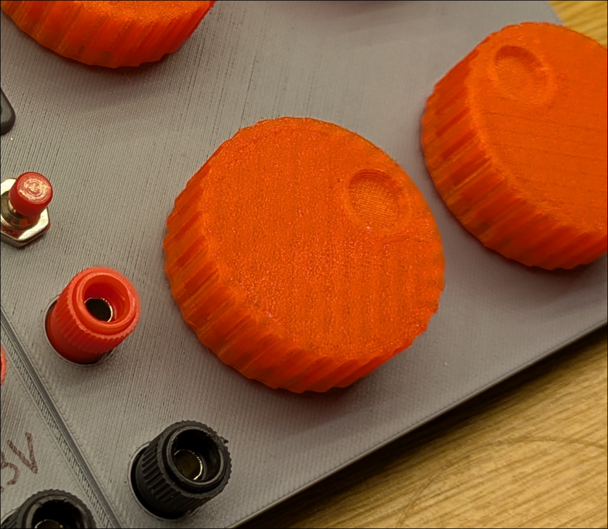
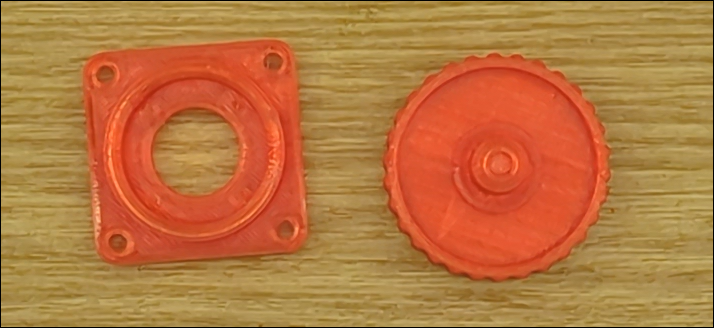
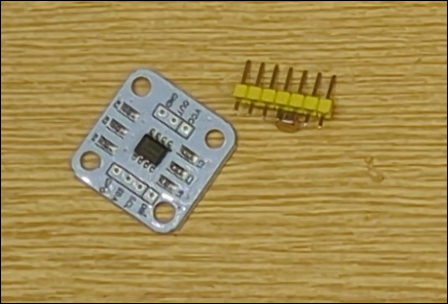
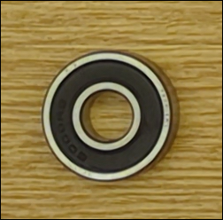
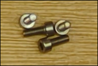
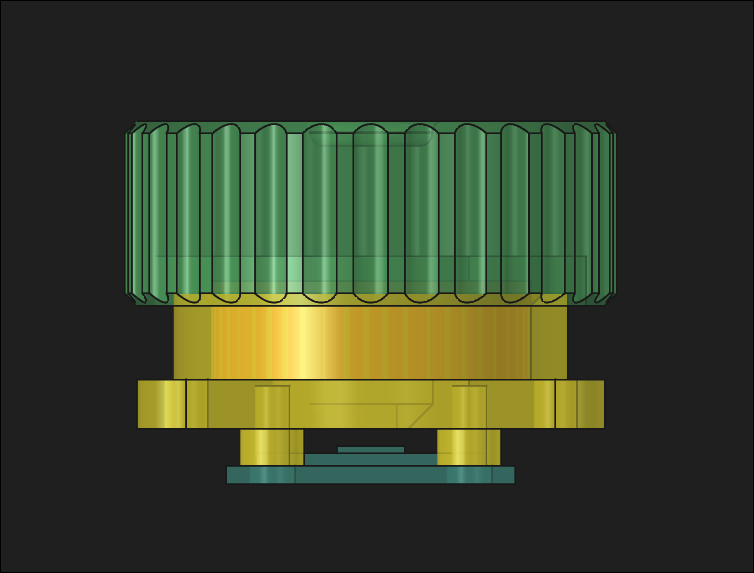
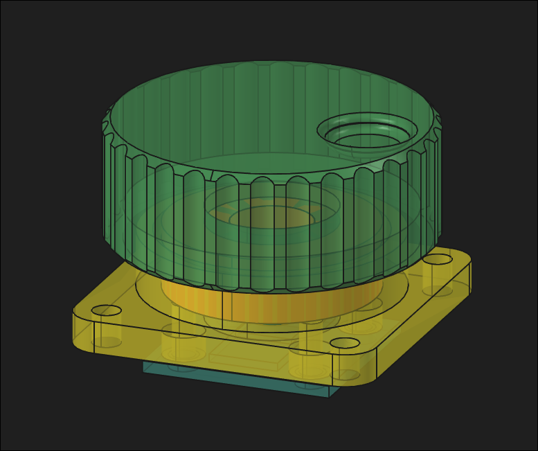
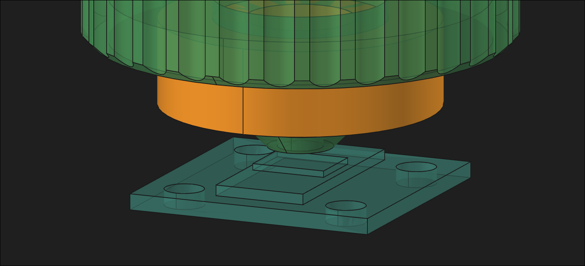

# Knob gallery

Photos and CAD views of the [AS5600 multi-turn knob](../README.md). The [CAD and assembly guide](../cad/README.md) has the printable files and hardware notes.

## Printed parts and components

| Printed knob | Printed body and knob |
|:--:|:--:|
|  |  |

| AS5600 breakout and pin header | 6000-series bearing | Small metal components |
|:--:|:--:|:--:|
|  |  |  |

## CAD assembly

| Side view | Transparent assembly |
|:--:|:--:|
|  |  |

## Video

[Watch the knob demonstration (MP4, 75 MB)](PXL_20261011_123336051.TS.mp4).
